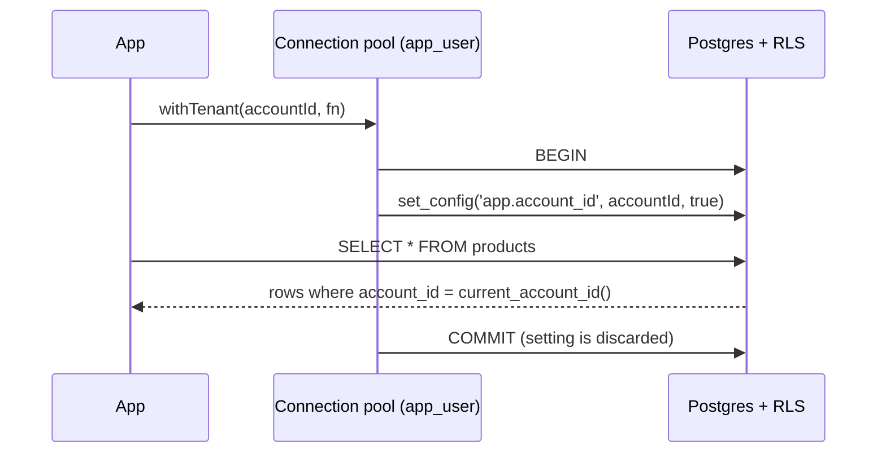

# multi-tenant-rls

[](https://github.com/TowerTKL/multi-tenant-rls/actions/workflows/ci.yml)

When many customers share the same database, the scariest bug is one customer seeing another one's data. This repo is a small example of letting Postgres handle that, so it doesn't depend on someone remembering a `WHERE account_id = ?`.

I kept only what matters: row-level security policies in the database, one `withTenant()` helper in the app, and tests that try to break it.

```ts
const products = await withTenant(accountId, (tx) => tx.select().from(productsTable));
// only this tenant's rows, even with no WHERE in the query
```

## How it works



1. **The app connects as `app_user`.** That role doesn't own the tables, isn't a superuser and has no `BYPASSRLS`. The policies are also `FORCE`d, so a table owner without `BYPASSRLS` would get filtered too. Superusers and roles with `BYPASSRLS` skip every policy, with or without `FORCE`. That's why the owner here (`postgres`, a superuser) only runs the migrations, the seed, the test setup and the demo's account list.
2. **Each table has one policy** that compares the row's account with `current_account_id()`: `account_id` on `stores`, `products` and `orders`, and `id` on `accounts`. The same check is used for `USING` (what you can read) and `WITH CHECK` (what you can write).
3. **`withTenant()` opens a transaction and sets the tenant** with `set_config(..., true)`. The `true` makes it local to the transaction, so it's gone after the commit or rollback, and a pooled connection can't carry tenant A into tenant B's request.
4. **Outside `withTenant()` there's no tenant**, so every table comes back empty. If someone forgets the helper, they get an empty screen, never another customer's data.

Two details that are easy to miss:

- `current_account_id()` wraps the setting in `nullif(..., '')`. After a custom setting has been used once on a connection, Postgres reads it back as an empty string instead of `NULL`, and `''::uuid` throws an error instead of just matching nothing.
- Child tables reference `stores (account_id, id)` with a composite foreign key. With RLS alone, tenant A could still insert an order with its own `account_id` and tenant B's `store_id`. The composite key blocks that.

## Watch out for roles that skip RLS

When RLS doesn't apply, nothing warns you. A superuser, or any role with `BYPASSRLS`, just sees every row, with no error. Before trusting the policies, check the role your app uses:

```sql
select rolname, rolsuper, rolbypassrls
  from pg_roles
 where rolname = current_user;
```

Both columns need to be `false`. The role also can't own the tables, unless every table uses `FORCE ROW LEVEL SECURITY`. Here, `app_user` is created with `nobypassrls`, isn't a superuser and doesn't own the tables.

## What the tests check

`test/isolation.test.ts` runs against a real Postgres with the pool limited to one connection, so every query uses the same connection:

| Scenario | Result |
| --- | --- |
| Tenant reads a table | only its own rows |
| Tenant asks for another tenant's row by id | empty |
| Query outside `withTenant()` | empty, on every table |
| Next query on the same connection after a tenant transaction | empty, nothing leaks |
| Two tenants requested at the same time (they queue on the one connection) | each sees only its own data |
| Update or delete another tenant's row | 0 rows affected |
| Insert a row stamped with another tenant's id | rejected by the policy (`42501`) |
| Point a row at another tenant's store | rejected by the foreign key (`23503`) |
| Malformed tenant id | rejected before it reaches the database |

## Running it

You need Node 22.9 or later, pnpm and Docker.

```bash
pnpm install
cp .env.example .env
docker compose up -d
pnpm db:migrate
pnpm test
```

To see it working:

```bash
pnpm db:seed
pnpm demo
# Bella Massa    sees: Portuguesa, Quatro Queijos
# Forno & Lenha  sees: Margherita, Calabresa
# no tenant      sees: 0 rows
```

## Files

```
migrations/0001_init.sql   tables, app_user role, current_account_id(), policies
src/db/schema.ts           Drizzle schema mirroring the migration
src/db/client.ts           runtime (app_user) and owner connections
src/db/tenant.ts           withTenant()
src/scripts/               migrate, seed, demo
test/isolation.test.ts     the tests above
```

## Notes

- The `app_user` password in the migration is only for local development and CI. In production, create the role outside the migrations and keep the password in a secret store.
- Since `set_config(..., true)` only lasts for the transaction, it also works behind a pooler in transaction mode, like PgBouncer. A session-level `SET` could leak from one client to the next there.
- RLS is a safety net, so don't make it the only check. In a real app I'd still filter every query and check permissions in the server action. The database is there for the day one of those gets missed.
- Migrations run as the owner on purpose. The seed and admin tasks skip RLS, the requests never do.

MIT license.
